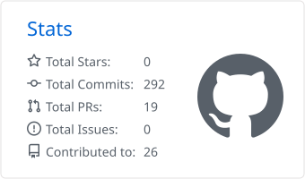
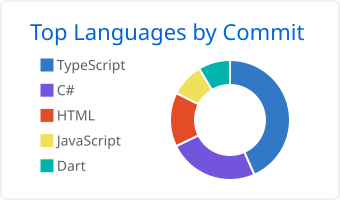
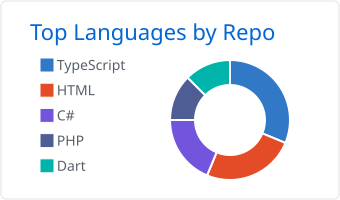
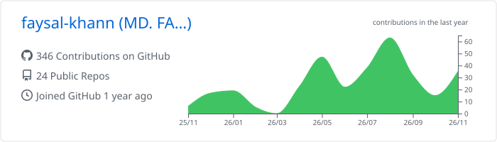

# Md. Faysal Khan

**Software Developer (Mobile & Full-Stack) | CS Undergraduate | AI / ML Enthusiast**

Dhaka & Chattogram, Bangladesh

---

## About Me

I am a Computer Science student at American International University-Bangladesh (BSc, Major in Information Systems, CGPA 3.95 / 4.00) and a Software Developer Intern in mobile development at Ultimate IT Solution.

My work centers on cross-platform mobile apps with React Native and Expo, backed by .NET, PHP and SQL databases. I also study Machine Learning, Deep Learning, Computer Vision, NLP and Data Science through coursework and projects.

I am looking for opportunities to contribute to real-world software and information-system projects while growing as a Software and AI Engineer.

---

## Technical Skills

**Programming Languages**

**Mobile Application Development**

**Frontend Development**

**Backend Development**

**Databases**

-4169E1?style=flat&logo=postgresql&logoColor=white)

**Cloud & Deployment**

**AI & Machine Learning**

Supervised and unsupervised learning, deep learning, computer vision, NLP, transfer learning, EDA, feature engineering and data visualization (Matplotlib, Seaborn).

**Development Tools**

Also: Visual Studio, XAMPP, MATLAB, CodeRabbit, Expo CLI, adb.

---

## Professional Experience

**Software Developer Intern (Mobile Development)** | Ultimate IT Solution, Chattogram | June 2026 - Present

- Learned React Native and Expo on the job and contributed to three production mobile applications.
- Built a real-time chat app integrating Stream Chat, Stream Video, Clerk authentication and Sentry error monitoring.
- Developed a property listing platform on Expo with Clerk authentication and a Supabase (PostgreSQL) backend, including Row-Level Security policies.
- Rebuilt the company's web-based POS system as a native mobile app with Supplier, Customer and Product modules.

---

## Featured Projects

### POS System (Mobile App + .NET API)

A retail point-of-sale system: a React Native / Expo mobile client backed by a .NET 10 Web API on Microsoft Azure with Azure SQL Database.

- **Stack:** React Native, Expo (SDK 57), TypeScript, NativeWind, Expo Router, ASP.NET Core (.NET 10), Entity Framework Core, SQL Server / Azure SQL, JWT
- **Features:** sales with held and draft carts, returns and refunds, barcode scanning and label generation, product image upload, stock and purchases, suppliers, customers with loyalty points, expenses, cashier shift closing, role and permission-based menus, receipts via print or WhatsApp, PDF export
- **Repositories:** [Mobile app](https://github.com/faysal-khann/POS-SYSTEM) | [.NET API](https://github.com/faysal-khann/POS_SYSTEM_.netapi)
- **Demo:** Android install link is in the mobile app README.

### Real-Time Chat App

Real-time messaging with voice and video, built during my internship.

- **Stack:** React Native, Expo, Stream Chat, Stream Video, Clerk, Sentry
- **Features:** real-time messaging, video calling, authentication, production error monitoring

### Property Listing Platform

Property listing and apartment-buying platform with secure, role-based data access.

- **Stack:** React Native, Expo, Clerk, Supabase (PostgreSQL)
- **Features:** authentication, listings, Row-Level Security policies for role-based access

### Other Projects

| Project | Stack | Summary |
| --- | --- | --- |
| Hotel Management System | C#, ASP.NET Core MVC, EF Core, SQL Server, Razor, Bootstrap | Role-based system with room booking, reservations, payments and admin reporting |
| Online Shopping Web App | HTML, CSS, JS, PHP, AJAX, MySQL | E-commerce site with authentication, product and user management, checkout |
| CVPR Coursework | TensorFlow, Keras, NumPy | AlexNet-style CNN, k-NN classifier and a NumPy neural network |
| Bus Ticket Management System | Oracle 10g, SQL | Relational database for passengers, tickets, buses, drivers and conductors |

---

## Education & Achievements

**BSc in Computer Science, Major in Information Systems** | American International University-Bangladesh (AIUB) | 2022 - Present | CGPA 3.95 / 4.00

**Higher Secondary Certificate (Science)** | Govt. Hazi Muhammad Mohsin College, Chattogram | 2021 | GPA 5.00 / 5.00

**Secondary School Certificate (Science)** | Government Muslim High School, Chattogram | 2019 | GPA 5.00 / 5.00

- Dean's Award for Academic Excellence, AIUB (Fall 2023-24, Spring 2023-24, Fall 2024-25)
- Merit-Based Scholarship (60%), AIUB

---

## Currently Learning

- Production React Native and Expo development (mobile architecture, EAS builds, error monitoring)
- ASP.NET Core and .NET 10 backend design with Clean Architecture
- Machine Learning, Deep Learning and Computer Vision, building on university coursework

---

## GitHub Overview

---

## Connect With Me

- LinkedIn: [faysal-khan-1a34883b3](https://www.linkedin.com/in/faysal-khan-1a34883b3/)
- GitHub: [faysal-khann](https://github.com/faysal-khann)
- Email: [faysaal70@gmail.com](mailto:faysaal70@gmail.com)
